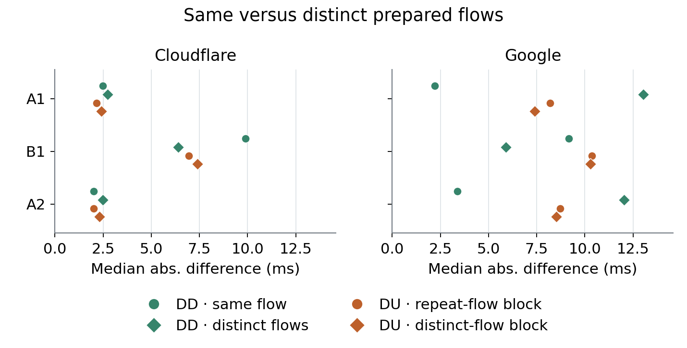

# DNS over HTTPS versus UDP

**Lookup latency and controlled browser loads**

Emirhan TEKBAŞ · Vistula University · Computer Engineering

Architecture of Computers (CII3SE003CI), 2026/2027

[Read the paper](Secure_DNS_Research_Paper.pdf) · [Check the evidence](docs/ARTIFACT_EVALUATION.md) · [Compare prior benchmarks](docs/RELATED_BENCHMARKS.md) · [Reproduce the results](docs/REPRODUCIBILITY.md)

## What the study tests

A DNS benchmark can report a precise delay while leaving three questions unanswered. How much depends on opening a socket? Does the estimate transfer to another session? How large are ordinary differences between repeated queries using the same protocol?

The study compares UDP and HTTP/2 DNS over HTTPS (DoH) at Cloudflare and Google. It checks timer boundaries with fresh and prebound UDP sockets, evaluates a fixed forecast against later sessions, and measures same-protocol variation alongside the cross-protocol comparison. Four effect bands from 0.5 to 5 ms show how interpretation changes with the stated scale.

The repeatability study contains 8,640 measured attempts across home Wi-Fi, a phone hotspot and a return to home Wi-Fi. One timeout is retained. Recorded local route properties matched across the home runs. The observed order leaves access context and elapsed time confounded.

## Main evidence

| Question | Evidence | Interpretation |
|---|---|---|
| How much does opening a socket matter? | Local loopback paired fresh-minus-prebound difference **+0.0775 ms**. Changing UDP baselines switched the sign of 2 of 10 Cloudflare window medians in the public control. | The local setup timer and the public baseline contrast measure different quantities. See [socket control](docs/CONTROL_RESULTS.md) and [loopback](docs/LOOPBACK.md). |
| Does a fixed estimate travel? | Google’s forecast against prebound UDP was **−0.94 ms**. The 22 November session medians were **+8.30, +9.99 and +8.62 ms**. The 23 November median was **−3.91 ms**. | The sign agreed in one of four observed sessions. See the [three-session results](docs/SESSION_EXTENSION_RESULTS.md) and the [additional-date score](results/additional_date.json). |
| How large are ordinary query differences? | For Cloudflare, the weighted shares above 2 ms for cross-mode pairs and same-flow DoH repeats were **54% / 56%** on A1, **84% / 92%** on B1 and **50% / 50%** on A2. | At matched positions and start intervals, ordinary DoH repeat differences were often as large as cross-mode differences. See both providers, flow conditions and all four bands in the [repeatability results](docs/REPEATABILITY_RESULTS.md). |
| Where does browser waiting accumulate? | In a fixed Chrome page, increasing the requested waiting time per image from 25 to 50 ms added **26.2 ms** in parallel and **210.9 ms** sequentially at the paired median. | The dependency graph and realized timer waits shape completion for this fixture. See the [live DNS fixture analysis](docs/BROWSER_PHASES.md) and the [separate delay-injection experiment](docs/BROWSER_LAYOUT.md). |



[Prior session medians and the frozen point forecast](figures/session_effects.png) · [Collection and network context](docs/evidence/repeatability-source-2026-11-23/README.md)

## Verify and rebuild

Extract the evidence ZIP and open a terminal in its root directory. Python 3.12+ runs the integrity check with the standard library.

```powershell
python scripts/validate_package.py
```

To recreate tables, plots and the PDF from the saved measurements, install the pinned Python packages and make Node.js 22+ available on PATH.

```powershell
python -m pip install -r requirements.txt
python scripts/reproduce.py
```

After dependency installation, the rebuild uses saved data and local tests. The [latest execution log](docs/evidence/verification.log) records the audit and rebuild. The manifest identifies the exact distributed bytes. Rebuilding refreshes generated metadata and the manifest. The raw collection ledgers retain the executed source and data hashes.

<details>
<summary>Recorded browser fixture and execution evidence</summary>


The capture records a separate fixture evidence run. See the [capture details and logs](docs/evidence/README.md) for the exact trial identifier.

</details>

## Navigate the artifact

| Location | Contents |
|---|---|
| [manuscript.md](manuscript.md) | Searchable version of the assessed paper |
| [data](data) · [data dictionary](docs/DATA_DICTIONARY.md) | Raw DNS messages, browser timing, trial schedules and field definitions |
| [scripts](scripts) · [tests](tests) | Collectors, independent Python decoder, statistical analysis, plots and regression tests |
| [results](results) · [figures](figures) | Derived results, complete denominators and figures in PNG, PDF and SVG |
| [evidence archives](docs/evidence/README.md) | Executed collector snapshots, plans, logs and capture metadata |
| [limitations](docs/LIMITATIONS.md) · [source audit](docs/SOURCE_AUDIT.md) | Scope and source-to-claim checks |
| [CITATION.cff](CITATION.cff) · [CHANGELOG.md](docs/CHANGELOG.md) | Citation metadata and release history |

For a new collection use a fresh output directory and follow the [measurement instructions](docs/REPRODUCIBILITY.md#collect-an-independent-replication). The public-resolver collectors use direct DNS to their documented endpoints. Chrome and Playwright are required only for collecting new browser observations.

## Interpretation

Same-provider destination addresses constrain the comparison. The actual anycast site, backend, recursive cache and Internet path remain unobserved. The timing unit is a client call through validation. For the browser work, Playwright fulfills fixed local bytes through both resource layouts. The live-DNS fixture and the synthetic gate experiment therefore address controlled browser completion. Broader page-load predictions require native DNS and origin measurements.
