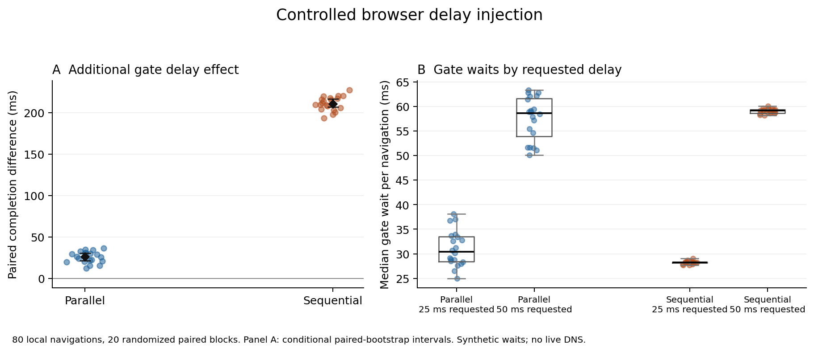
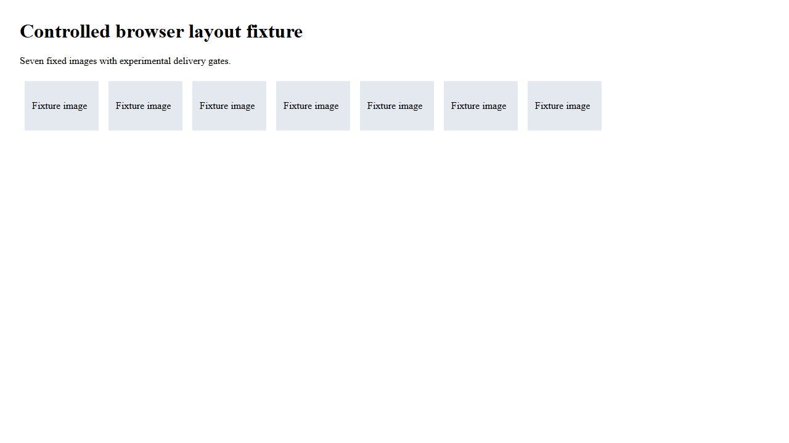

# Controlled browser delay and layout experiment

This is a separate causal delay-injection experiment in real headless Chrome. Its gate durations are synthetic treatments. It does not measure DNS, native browser resolution or Internet website loading.

## Design

The same HTML and seven identical SVG payloads were used throughout. Seven distinct fixture hostnames were fulfilled by Playwright routing. Main-document delivery had no added delay. Resource gates requested 25 ms at baseline and 50 ms in treatment. Each randomized repetition block included both delays under sequential and parallel image scheduling. The completed run contains 80 navigations (20 per condition).

Sequential JavaScript awaited each image's load before assigning the next image URL. Parallel JavaScript assigned all seven URLs before awaiting their joint completion. Actual gate intervals and browser request/completion timestamps verify these dependencies. The primary outcome is the interval from fixture script start to all seven verified image completions. Navigation Timing load-event end is retained only as a diagnostic.

## Measured paired effects

| Layout | Complete pairs | Median treatment − baseline ms | Conditional 95% interval ms | Delay-only model increment ms |
| --- | ---: | ---: | --- | ---: |
| parallel | 20 | +26.20 | [+21.40, +30.40] | 25 |
| sequential | 20 | +210.90 | [+207.00, +216.65] | 175 |

The median paired interaction (sequential increment minus parallel increment within a repetition) was +186.95 ms, with a conditional interval of [+176.80, +194.10] ms. The model column is an idealized prediction from the assigned delay and dependency graph; it is not a measured DNS result.

## Validation and interpretation

Independent checks accepted 80/80 records. They verified fixed payload hashes, distinct gates, successful image completion, browser sequence ordering and recomputed concurrent gate counts. Unexpected context requests were aborted and logged. Wildcard host resolution was disabled for the browser. The collector contacted no public DNS resolver or content host.

The experiment tests whether the resource dependency graph changes how an injected wait accumulates. It does not estimate encryption cost, native resolver policy or user-perceived performance on arbitrary websites. Paired bootstrap intervals condition on this host, run, fixture and timing treatments. Browser/runtime scheduling and route fulfillment remain part of the measured interval.

Raw files are in the matching data/browser-layout directory; the analysis produces summary.json, marginal_summary.csv, paired_effects.csv, paired_observations.csv and gate_audit.csv. The design, schedule, environment, constant payload bytes and screenshots accompany the recorded observations.
## Realized gate waits and supplementary figure

Nominal gate targets were 25 and 50 ms. Realized waits were measured independently from route-entry to release. The following pooled gate summaries are descriptive; gates within a page are correlated. Overshoot includes timer and event-loop scheduling and does not identify a particular operating-system mechanism.

| Layout | Requested ms | Pages / gates | Median actual wait ms | Median overshoot ms | Actual wait IQR ms |
| --- | ---: | ---: | ---: | ---: | --- |
| parallel | 25 | 20 / 140 | 30.59 | +5.59 | [28.42, 33.61] |
| parallel | 50 | 20 / 140 | 58.68 | +8.68 | [53.96, 61.76] |
| sequential | 25 | 20 / 140 | 28.21 | +3.21 | [27.70, 28.78] |
| sequential | 50 | 20 / 140 | 59.21 | +9.21 | [58.33, 59.75] |

For each trial, the union of the seven timer intervals measures time with at least one gate waiting and counts overlap only once. In a descriptive secondary analysis, the median paired increase in this union was **+27.52 ms** in the parallel layout and **+212.37 ms** in the sequential layout. The [paired union data](../results/browser-layout-2026-11-22/paired_gate_union.csv) use the route timer. Browser completion uses the browser clock and includes dispatch, fulfillment and image handling.

Panel A shows all paired completion changes and the layout-specific medians with conditional intervals. Panel B shows each navigation’s median actual gate wait, with boxes spanning the IQR and whiskers the full observed range. The figure contains measured browser outcomes under explicitly synthetic delay treatments.

The sequential and parallel screenshots have the same appearance because resource bytes and layout are fixed. Their execution dependencies differ. Raw execution snapshots and payload hashes are recorded in design.json. SHA256SUMS.txt in the raw-data directory covers the captured files, excluding itself. These local hashes detect subsequent changes.
