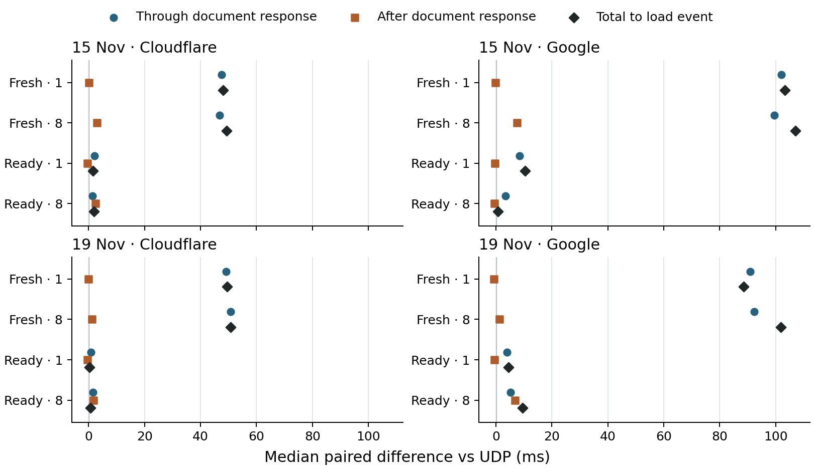

# Interpreting the controlled browser experiment

The fixed HTML document and seven SVG images use one or eight hostnames. Playwright waits for validated live DNS before fulfilling a request with local bytes. The single-name layout uses one lookup. In the eight-name layout, the document lookup precedes the image requests and the seven later gates can overlap. The browser runs its normal HTML parsing and image loading on this controlled resource graph.

For each complete pair, the load-event difference is the change through document response end plus the change from response end to load-event end. Those two phases use the same Navigation Timing clock. Separate medians of the two paired changes generally do not add up to the median total. The phases include browser and fixture handling. The first phase cannot be read as a direct measure of DNS latency and the second can overlap document parsing and resource work.

Positive values indicate a longer measured phase for DoH. Every point uses the median of within-block differences over 30 complete pairs. Fresh means HTTP/2 setup occurs in the document gate. Ready means that setup occurs before navigation. The numbers 1 and 8 indicate the number of hostnames. The numerical output is [available as CSV](../results/browser_phases.csv). A [vector PDF](../figures/browser_phases.pdf) and [SVG version](../figures/browser_phases.svg) are included.

Across the four date and provider combinations, the one-hostname fresh-session contrast through document response end ranges from +47.45 to +102.05 ms. Its post-response median remains within 0.70 ms of zero. With eight hostnames, the corresponding post-response fresh-session medians range from +1.20 to +7.55 ms. This difference in timing is consistent with the fixture design and observed parallelism opportunity. Resource-gate start and end timestamps were not collected, so the analysis cannot reconstruct an exact critical path or quantify the amount of overlap.

A real website can add browser resolver policies, DNS prefetching, cache hits, CDN-dependent origin selection, simultaneous connection establishment, transfer, and dynamic content. The fixture controls those variables through interception. Translating its milliseconds to a site would require measurements of that site's native DNS and request graph. The [original method](METHODS.md) contains the fixture and matching details.
