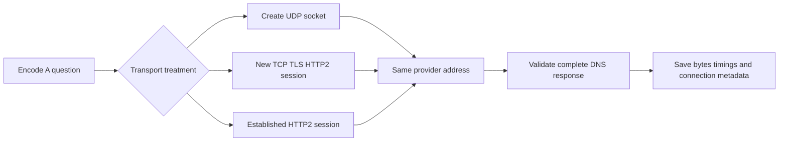
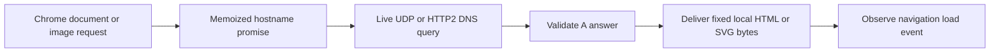

# Experimental controls and measurement scopes

The original methods below apply to 15 and 19 November 2026. The 20 November [socket control](CONTROL_ANALYSIS_PLAN.md) adds fresh explicitly bound UDP and reused prebound UDP to compare with ready DoH. The [follow-up tables](CONTROL_RESULTS.md) retain whole-call and post-bind timings and evaluate transfer across time windows. The [navigation phase analysis](BROWSER_PHASES.md) uses the original browser records.

## Three questions, three outcomes

1. **Lookup condition:** What is the observed within-provider difference between UDP and either fresh or established HTTP/2 DoH?
2. **Context sensitivity:** Does the direction of an established-session contrast persist across the observed windows and two collection dates?
3. **Browser dependency:** How does waiting for live DNS propagate through a fixed one- or eight-hostname resource graph?

These questions do not measure resolver CPU cycles, a controlled recursive-cache miss, or general native-browser website speed.

## Lookup path

Equivalent DNS semantics use recursion desired, A type and Internet class. IDs are independently generated and validated. UDP does not advertise an EDNS buffer. Truncation is a failure without TCP fallback. DoH uses the wire-format endpoint, binary POST and certificate verification.

| Comparison factor | Treatment |
|---|---|
| Resolver provider | Cloudflare and Google analyzed independently |
| Provider address | 1.1.1.1 or 8.8.8.8, including pinned DoH connection |
| Endpoint hostname | Preserved for SNI, HTTP authority and certificate checks |
| Local stub cache | Bypassed through direct wire-query clients |
| Recursive cache | Prewarming attempted; hit/miss status remains unknown |
| Fresh lookup DoH | New client and TCP/TLS/HTTP2 connection per query |
| Established lookup DoH | One primed session per provider and window |
| Fresh page DoH | One connection opened inside the main-document gate, shared across page names |
| Established page DoH | One session opened and primed before navigation |
| TLS resumption | Recorded and checked rather than assumed |
| Sequence | Seeded randomized protocol order within matched blocks |
| Retries | None; attempts and errors retained |

## Browser path

The returned A addresses are recorded but not contacted. The fixture is therefore a DNS-gated browser experiment. Its one-hostname layout has one lookup despite seven images. Its eight-hostname layout resolves the document hostname first, then allows the seven image-hostname requests to overlap. Promise memoization covers queries already in flight as well as completed queries.

The content is held fixed while DNS transport changes. This removes remote origin behavior but also excludes native browser resolver policy, browser DNS prefetching, address racing, origin TLS, remote content transfer, CDN selection and real website rendering complexity. Browser process reuse, new contexts and blocked service workers are recorded procedural choices.

## Timing boundaries

| Field | Start and stop | Interpretation |
|---|---|---|
| Direct UDP `elapsed_ms` | Before socket creation to complete validated reply | Client-and-network elapsed lookup time |
| Direct fresh DoH `elapsed_ms` | After query encoding, before lazy connection setup, to validated reply | Includes connection establishment |
| Established DoH `elapsed_ms` | After encoding, through query on an existing session, to validated reply | Excludes earlier connection establishment |
| DoH `connect_ms` | Connection attempt to negotiated HTTP/2/TLS readiness | Library-level connection-stage diagnostic |
| Page DNS `gate_ms` | Before explicit connection/query work to validated gate completion | Includes fresh page setup where applicable |
| Page `plt_ms` | Navigation start to `loadEventEnd` | Completion of the fixed document and images |

Application timers include local handling and network waits. Connection-stage subtraction is descriptive; it does not isolate encryption, and medians of components need not sum to the median total.

## Paired contrast and aggregation

For a matched block b, let d(b) = t(DoH, b) − t(UDP, b). The primary estimate is median over d(b). It is not median(t(DoH)) − median(t(UDP)). Each lookup block fixes provider, domain, window and repetition. Each browser block fixes provider, layout, window and repetition. Nested resource queries are not independent pages.

All-attempt counts and success counts are separate. Paired latency estimates condition on both compared attempts succeeding. Missing records, discordant successes and both-failed pairs are reported rather than silently dropped from the audit trail.

The primary bootstrap keeps window counts fixed and samples paired blocks within observed windows. The domain-cluster check samples ten hostname clusters while preserving the repetitions and windows attached to a selected name. Both are conditional analyses. The latter does not solve time dependence, and neither samples new users or networks.

## Dates and software

The dates use the same workload and host but have separately recorded software versions and network context. A calendar-date contrast is not a randomized treatment. Original and repeat results are retained separately, including any disagreement. See [the reproduction guide](REPRODUCIBILITY.md) for exact versions and [the limitations](LIMITATIONS.md) for remaining confounders.
