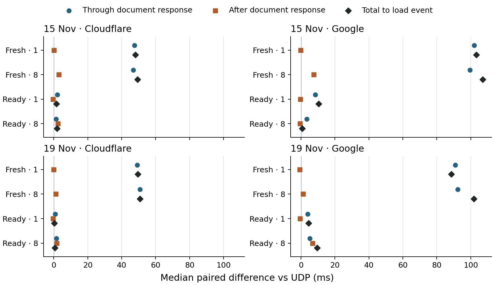

# DNS over HTTPS versus UDP

## Lookup Latency and Controlled Browser Loads

{{IDENTITY}}

### Abstract

DNS over HTTPS (DoH) incurs setup when opening a new session. Differences against UDP also depend on socket lifetime and measurement context. We compared fresh and established HTTP/2 DoH and UDP using matched IPv4 A queries to Cloudflare and Google. A socket control included fresh and prebound UDP, and a loopback experiment timed local socket readiness. {{ABSTRACT_CONTROL}} {{SESSION_ABSTRACT}} {{DATE_ABSTRACT}} {{REPEATABILITY_ABSTRACT}} A separate browser fixture released fixed content after validated live DNS. For both providers and layouts on both historical browser dates, the median fresh DoH change was larger through document response end than afterward. {{LAYOUT_ABSTRACT}} The latter experiment manipulated synthetic waits in a fixed resource graph. Together the experiments show how timer boundaries, ordinary sequential query variation and session changes affect a benchmark. Same-protocol repeats provide a reference for the observed size of cross-protocol differences. Held-out session forecasts quantify how often a fixed comparison transfers under the observed conditions.

Keywords: DNS over HTTPS, UDP socket reuse, lookup latency, temporal variation, browser fixture

## Introduction and related work

DNS resolution can delay an application before it opens an origin connection. Conventional DNS commonly uses UDP (Mockapetris, 1987). DNS over HTTPS maps DNS messages onto HTTPS (Hoffman & McManus, 2018). An elapsed lookup includes network, resolver and client work. Le Louët et al. (2024) also measured resolver CPU and memory, outcomes that require instrumentation beyond a client timer.

Chhabra et al. (2021) compared DoH with default client resolution across countries and used names under their control to induce recursive cache misses. Their results assess deployment across a broad population. Here, each protocol uses the same operator and destination IP. Fixed names and repeated windows allow a closer look at the client baseline and temporal variation on one host. Recursive cache hits remain unverified. Böttger et al. (2019) and Hounsel et al. (2021) already distinguish connection setup from later lookups. Izhikevich et al. (2022) use long-lived UDP sockets to improve bulk DNS measurement throughput. That design motivates testing UDP socket lifetime for individual query latency under the same workload.

We ask how the UDP socket lifecycle changes a ready-session comparison, how well a fixed forecast transfers, and how cross-protocol differences compare with same-mode repeats across prepared flows. Transport ports can influence flow assignment (Augustin et al., 2006). Hounsel et al. (2020) measured real sites. Our browser fixtures hold content fixed to examine resource dependencies. Related work addresses DoQ, HTTP/3 and cross-layer reuse (Bielefeld et al., 2026; Kosek et al., 2022; Sengupta et al., 2024). The transport specifications distinguish those protocols from HTTP/2 DoH (Bishop, 2022; Huitema et al., 2022).

## Methodology

### Host, resolvers and historical sessions

{{ENVIRONMENT}}

Cloudflare used 1.1.1.1 and cloudflare-dns.com. Google used 8.8.8.8 and dns.google. DoH binary POST requests used /dns-query, with the provider IP pinned and the hostname retained for TLS certificate validation and HTTP authority. Clients required negotiated HTTP/2 (Thomson & Benfield, 2022). IPv4 A queries requested recursion and omitted EDNS. The ten names were example.com, wikipedia.org, mozilla.org, github.com, cloudflare.com, google.com, microsoft.com, apple.com, bbc.com and amazon.com. Direct DNS messages bypassed the OS stub. Priming encouraged reuse, with recursive cache state unobserved. {{CACHE_AND_ANYCAST_CITATION}}

On 15 and 19 November, each session randomized UDP, fresh DoH and established DoH within provider, name, window and repetition. Three windows and ten repetitions yielded 1,800 measured lookups per date. UDP included implicit binding. Fresh DoH included new TCP, TLS and HTTP/2 setup. Established DoH reused a primed session. Timers started after DNS query construction and stopped after validation.

### Follow-up socket control

The follow-up retained the two providers and ten names. It randomized fresh UDP, prebound reused UDP and established DoH within each matched block. Fresh UDP applied an explicit bind inside its timer to expose setup. The full call also included initiating close. Reused UDP kept one unconnected, prebound socket per provider and window. DoH used one primed HTTP/2 session per provider and window. The ready-state contrast uses the elapsed calls for prebound UDP and established DoH through response validation. We also compare UDP send to validated receipt after binding in both modes. UDP has no remote connection handshake in either mode. Port reuse can affect network treatment, so local ports were recorded. {{CONTROL_DESIGN}}

The loopback calibration randomized fresh and prebound UDP lookups against a fixed responder in the same process. It reused the DNS message and validation helpers in a separate socket harness. Whole-call and ready-to-validation timers isolate the local packet path from remote routes and caches.

### Same-protocol repeatability

{{REPEATABILITY_METHOD}}

### Session replication and effect magnitude

{{SESSION_DESIGN}}

{{DATE_METHOD}}

A locally frozen plan applied 20 November paired medians as fixed forecasts. We score session-level error, sign and categories at ±0.5, ±1, ±2 and ±5 ms per lookup. The descriptive bands probe sensitivity to scale without utility calibration. Median absolute differences and exceedance rates describe variation even when the signed median is near zero.

### Controlled browser experiment

The two historical sessions used fresh UDP for the browser baseline. Playwright fulfilled one HTML document and seven SVG images after live DNS returned a valid answer. The one-name layout shared a single hostname lookup, while the eight-name layout could overlap the seven image lookups after the document. Address records were recorded. The fixture served local bytes and excluded origin connections, site TLS, CDN transfer and Chrome’s native DNS behavior. Fresh DoH opened one shared session during the document gate. Established DoH primed a session before navigation. A new browser context blocked service workers. Each date contained 360 randomized fixture navigations, with thirty per provider, layout and treatment.

Navigation Timing records document response end and load-event end (Weiss & Rosenthal, 2026). For each successful matched pair, the load difference equals the difference through document response plus the difference from response end to load. The phases include browser work and scheduling. Separate medians of these paired changes need not sum to the median total.

{{LAYOUT_METHOD}}

### Validation and inference

Independent decoding checks transaction identity, the question and whether the answer is reachable through its CNAME chain. Audits verify UDP source, socket reuse and HTTP/2 metadata. Counts retain failures. Latency contrasts use complete successful pairs. Positive DoH-minus-UDP values indicate slower DoH.

Historical percentiles use 4,000 paired resamples within observed windows. Domain-level sensitivity preserves observations attached to each name (Field & Welsh, 2007). A retrospective check fits the pooled sign on five windows and scores the sixth. The 20 November prediction used the pooled historical Google sign against fresh UDP. An order audit found six distinct schedules in twelve 22–23 November windows because the old collector added session seed and window index. The repeatability collector derives streams from labeled tuples.

## Results

### Historical lookup contrasts

{{COMPLETENESS}}

{{PRIMARY_LOOKUP_RESULTS}}

### UDP socket control

{{CONTROL_RESULTS}}

{{CONTROL_TABLE}}

{{LOOPBACK_RESULTS}}

### Same-protocol and cross-protocol differences

{{REPEATABILITY_RESULTS}}

### Direction and uncertainty across windows

{{HISTORY_TRANSFER}}

{{HISTORY_FIGURE}}

{{FOLLOWUP_TRANSFER}}

### Forecast transfer between sessions

{{SESSION_RESULTS}}

{{SESSION_FIGURE}}

{{DATE_RESULTS}}

### Controlled browser timings

{{BROWSER_PHASE_RESULTS}}

{{BROWSER_CAPTION}}

{{LAYOUT_RESULTS}}

## Discussion

{{CONTROL_INTERPRETATION}}

Matched same-mode repeats put small cross-mode differences in context, and using distinct prepared flows checks sensitivity to flow assignment. Pairs share attempts and windows. Estimates condition on successful comparable starts. Client flows can share routes. Run differences can combine access, time and resolver effects. We apply no jitter correction.

Chhabra et al. (2021) sampled variation across client networks. Here the unit of evidence for forecast transfer is an observed window or session on one host. A narrow conditional interval describes the composition of fixed windows. Front ends, routing, caches and traffic could contribute to changes between them. {{SESSION_LIMITS}}

Google's contrast crossed zero between verification dates with matched software and timing boundaries. Direction can change across evenings even when medians agree within an evening. Effect bands test transfer at specific lookup scales.

The historical live-DNS fixture places the larger fresh-session difference before document response end. Its records lack per-resource gate timestamps. The new synthetic-delay experiment records them and includes browser scheduling in completion time. Real sites also add native resolver behavior, caching, origin connections and content transfer.

## Conclusion

{{SESSION_CONCLUSION}} Small established-session contrasts require an explicit UDP timing boundary and a report of variation between sessions. Controlled browser timing depends on where the DNS wait falls in the resource graph.

## Declaration of Generative AI and AI-Assisted Technologies

OpenAI Codex assisted with design, source discovery, code, measurement execution, analysis and drafting. Automated checks audited responses and recalculated results. The submitting author remains responsible for independent verification, understanding and the final interpretation.

## Data and code availability

The accompanying version 1.2.0 evidence ZIP contains code, raw measurements, metadata and figures. The project repository is {{REPOSITORY_URL}}. The file-level SHA-256 manifest identifies the distributed artifact. {{REPRODUCIBILITY_CITATION}}

## References

{{REFERENCES}}
