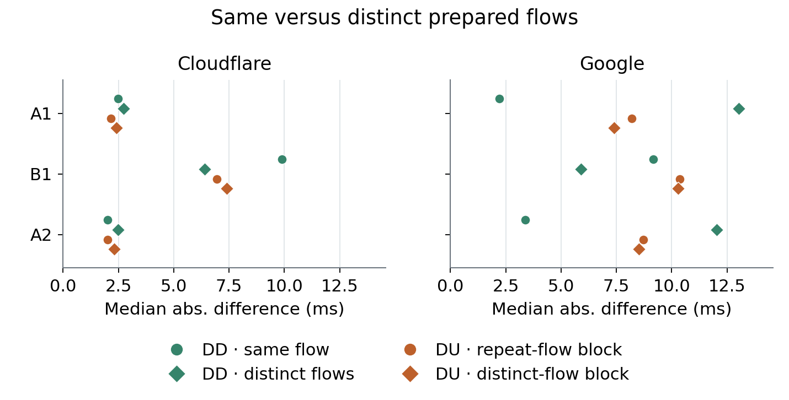
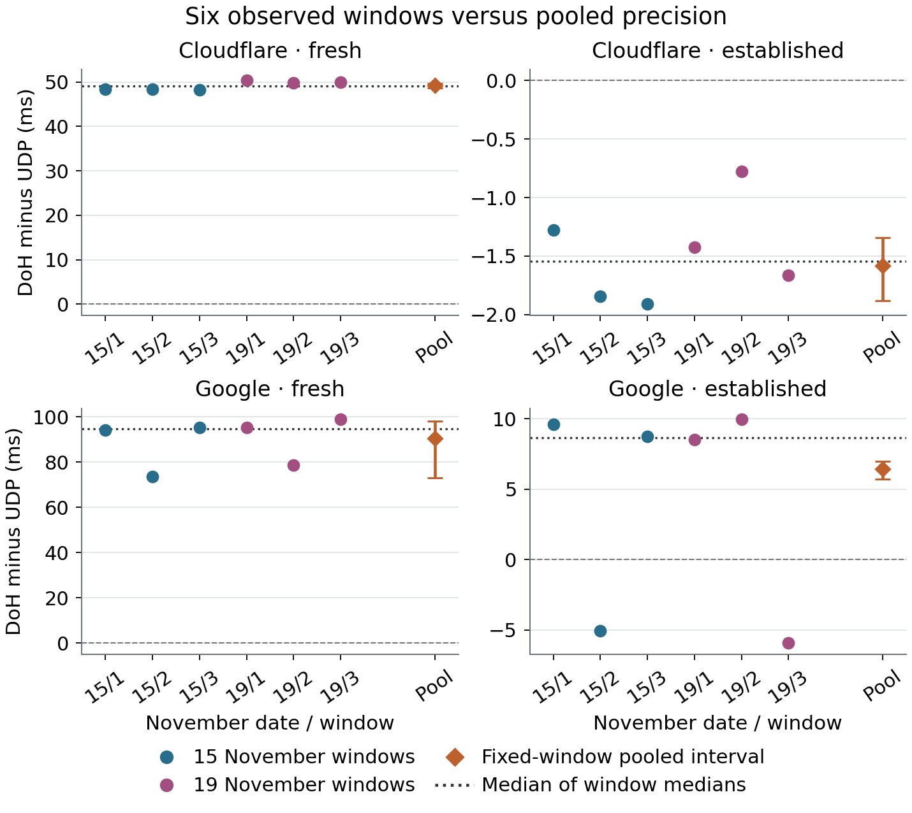
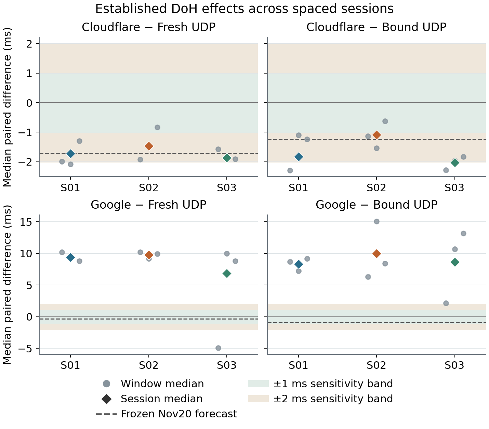
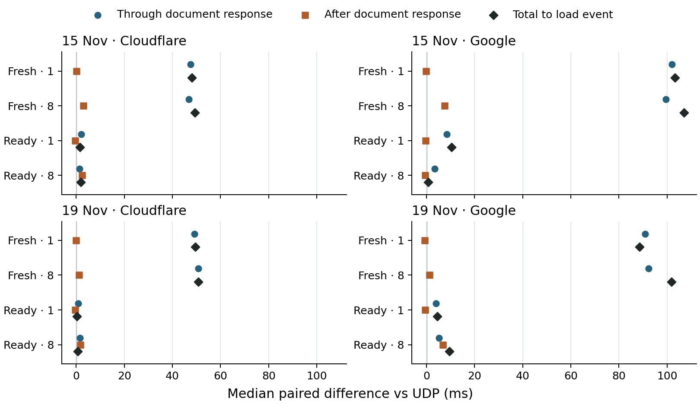

# DNS over HTTPS versus UDP

## Lookup Latency and Controlled Browser Loads

Emirhan TEKBAŞ

Student ID: 75831

Vistula University

Computer Engineering

Architecture of Computers (CII3SE003CI), 2026/2027

### Abstract

DNS over HTTPS (DoH) incurs setup when opening a new session. Differences against UDP also depend on socket lifetime and measurement context. We compared fresh and established HTTP/2 DoH and UDP using matched IPv4 A queries to Cloudflare and Google. A socket control included fresh and prebound UDP, and a loopback experiment timed local socket readiness. Across 6,000 follow-up attempts, median fresh UDP setup was about 0.13 ms. Prebound UDP reversed the Cloudflare comparison in 2 of 10 windows. A 20 November calibration forecast was then held fixed for 5,400 attempts across three 22 November evening sessions. Against prebound UDP, the forecast matched 0 of 3 Google session signs. A separate 23 November session measured a Google median of -3.91 ms against the ready UDP baseline. Across 8,640 repeatability attempts, we compared same-mode and cross-mode differences at matched start intervals. In the initial Cloudflare run the weighted shares beyond 2 ms were 38% for UDP repeats, 56% for DoH repeats and 54% across modes. A separate browser fixture released fixed content after validated live DNS. For both providers and layouts on both historical browser dates, the median fresh DoH change was larger through document response end than afterward. Raising each requested wait by 25 ms yielded median paired completion increases of 26 ms with parallel and 211 ms with sequential requests. The latter experiment manipulated synthetic waits in a fixed resource graph. Together the experiments show how timer boundaries, ordinary sequential query variation and session changes affect a benchmark. Same-protocol repeats provide a reference for the observed size of cross-protocol differences. Held-out session forecasts quantify how often a fixed comparison transfers under the observed conditions.

Keywords: DNS over HTTPS, UDP socket reuse, lookup latency, temporal variation, browser fixture

## Introduction and related work

DNS resolution can delay an application before it opens an origin connection. Conventional DNS commonly uses UDP (Mockapetris, 1987). DNS over HTTPS maps DNS messages onto HTTPS (Hoffman & McManus, 2018). An elapsed lookup includes network, resolver and client work. Le Louët et al. (2024) also measured resolver CPU and memory, outcomes that require instrumentation beyond a client timer.

Chhabra et al. (2021) compared DoH with default client resolution across countries and used names under their control to induce recursive cache misses. Their results assess deployment across a broad population. Here, each protocol uses the same operator and destination IP. Fixed names and repeated windows allow a closer look at the client baseline and temporal variation on one host. Recursive cache hits remain unverified. Böttger et al. (2019) and Hounsel et al. (2021) already distinguish connection setup from later lookups. Izhikevich et al. (2022) use long-lived UDP sockets to improve bulk DNS measurement throughput. That design motivates testing UDP socket lifetime for individual query latency under the same workload.

We ask how the UDP socket lifecycle changes a ready-session comparison, how well a fixed forecast transfers, and how cross-protocol differences compare with same-mode repeats across prepared flows. Transport ports can influence flow assignment (Augustin et al., 2006). Hounsel et al. (2020) measured real sites. Our browser fixtures hold content fixed to examine resource dependencies. Related work addresses DoQ, HTTP/3 and cross-layer reuse (Bielefeld et al., 2026; Kosek et al., 2022; Sengupta et al., 2024). The transport specifications distinguish those protocols from HTTP/2 DoH (Bishop, 2022; Huitema et al., 2022).

## Methodology

### Host, resolvers and historical sessions

The historical host ran Windows 10.0.26200 x64 on an AMD Ryzen 7 7700 8-Core Processor, with 16 logical processors and 30.9 GiB RAM. Node.js versions were v24.22.1 and v24.22.3. Chrome versions were 157.0.8103.51 and 157.0.8103.79, with Playwright 1.62.1.

Cloudflare used 1.1.1.1 and cloudflare-dns.com. Google used 8.8.8.8 and dns.google. DoH binary POST requests used /dns-query, with the provider IP pinned and the hostname retained for TLS certificate validation and HTTP authority. Clients required negotiated HTTP/2 (Thomson & Benfield, 2022). IPv4 A queries requested recursion and omitted EDNS. The ten names were example.com, wikipedia.org, mozilla.org, github.com, cloudflare.com, google.com, microsoft.com, apple.com, bbc.com and amazon.com. Direct DNS messages bypassed the OS stub. Priming encouraged reuse, with recursive cache state unobserved. TTL policy and distributed caching affect response time (Moura et al., 2019), while routing determines which physical anycast site a service address reaches (de Oliveira Schmidt et al., 2017).

On 15 and 19 November, each session randomized UDP, fresh DoH and established DoH within provider, name, window and repetition. Three windows and ten repetitions yielded 1,800 measured lookups per date. UDP included implicit binding. Fresh DoH included new TCP, TLS and HTTP/2 setup. Established DoH reused a primed session. Timers started after DNS query construction and stopped after validation.

### Follow-up socket control

The follow-up retained the two providers and ten names. It randomized fresh UDP, prebound reused UDP and established DoH within each matched block. Fresh UDP applied an explicit bind inside its timer to expose setup. The full call also included initiating close. Reused UDP kept one unconnected, prebound socket per provider and window. DoH used one primed HTTP/2 session per provider and window. The ready-state contrast uses the elapsed calls for prebound UDP and established DoH through response validation. We also compare UDP send to validated receipt after binding in both modes. UDP has no remote connection handshake in either mode. Port reuse can affect network treatment, so local ports were recorded. On 20 November, 10 windows targeted 90 seconds between starts. Each included 10 repetitions and priming across all treatments. The host used Windows 10.0.26300 and Node.js v24.22.3.

The loopback calibration randomized fresh and prebound UDP lookups against a fixed responder in the same process. It reused the DNS message and validation helpers in a separate socket harness. Whole-call and ready-to-validation timers isolate the local packet path from remote routes and caches.

### Same-protocol repeatability

Each run interleaved two UDP and two DoH queries per block. All six protocol orders were used for same-flow repeats and repeats on distinct prepared flows. Each provider had two sockets and two HTTP/2 sessions per window. Three windows yielded 2,880 measured attempts per run. The primary analysis matches adjacent positions with 75–125 ms between actual starts across randomized orders. We weight windows and common cells equally. On one host, A1 used home Wi-Fi, B1 used a phone hotspot by user report, and A2 returned to home Wi-Fi with matching recorded local route properties. Local starts were A1 23 Nov 22:49, B1 24 Nov 11:20, A2 24 Nov 11:34.

### Session replication and effect magnitude

The 20 November calibration started at 13:16 Warsaw time. On 22 November, three held-out sessions started around 21:06, 21:18 and 21:30 Warsaw time, covering 27 minutes from first start to last finish. Each ran three windows with the socket-control design. The operating-system release and runtime versions matched the calibration. The only collector code change was an up-front transaction ID budget check. The planned and actual times are retained.

A separate 23 November verification used the same design and frozen forecasts, with a new seed. Its plan was recorded after the first evening extension and before this run. It adds one held-out date.

A locally frozen plan applied 20 November paired medians as fixed forecasts. We score session-level error, sign and categories at ±0.5, ±1, ±2 and ±5 ms per lookup. The descriptive bands probe sensitivity to scale without utility calibration. Median absolute differences and exceedance rates describe variation even when the signed median is near zero.

### Controlled browser experiment

The two historical sessions used fresh UDP for the browser baseline. Playwright fulfilled one HTML document and seven SVG images after live DNS returned a valid answer. The one-name layout shared a single hostname lookup, while the eight-name layout could overlap the seven image lookups after the document. Address records were recorded. The fixture served local bytes and excluded origin connections, site TLS, CDN transfer and Chrome’s native DNS behavior. Fresh DoH opened one shared session during the document gate. Established DoH primed a session before navigation. A new browser context blocked service workers. Each date contained 360 randomized fixture navigations, with thirty per provider, layout and treatment.

Navigation Timing records document response end and load-event end (Weiss & Rosenthal, 2026). For each successful matched pair, the load difference equals the difference through document response plus the difference from response end to load. The phases include browser work and scheduling. Separate medians of these paired changes need not sum to the median total.

A separate randomized Chrome experiment used the same seven image payloads under two request dependencies and gate waits of 25 and 50 ms. Sequential code waited for each image load before requesting the next. Parallel code issued all requests before awaiting completion. The primary outcome was script start to verified image completion. Request and gate timestamps checked the intended dependencies. Injected delays model waiting at the gate, and this experiment uses local bytes.

### Validation and inference

Independent decoding checks transaction identity, the question and whether the answer is reachable through its CNAME chain. Audits verify UDP source, socket reuse and HTTP/2 metadata. Counts retain failures. Latency contrasts use complete successful pairs. Positive DoH-minus-UDP values indicate slower DoH.

Historical percentiles use 4,000 paired resamples within observed windows. Domain-level sensitivity preserves observations attached to each name (Field & Welsh, 2007). A retrospective check fits the pooled sign on five windows and scores the sixth. The 20 November prediction used the pooled historical Google sign against fresh UDP. An order audit found six distinct schedules in twelve 22–23 November windows because the old collector added session seed and window index. The repeatability collector derives streams from labeled tuples.

## Results

### Historical lookup contrasts

The original and second sessions recorded 0 and 0 failed measured attempts, respectively. The 3,600 lookups and 720 navigations passed the saved-packet and transport audits.

Median paired fresh-DoH differences on 15 and 19 November were +48.4 and +50.1 ms for Cloudflare, and +84.6 and +91.2 ms for Google.

### UDP socket control

The follow-up recorded 6,000 measured attempts and 0 measured failures. The median interval from fresh UDP call start through binding was 0.13 ms for Cloudflare and 0.13 ms for Google. Table 1 contrasts whole-call and post-bind UDP differences and gives each DoH comparison against its own UDP baseline.

Table 1. Socket-control median paired differences in milliseconds.

| Provider | Fresh − bound UDP, whole call | Fresh − bound UDP, after bind | DoH − fresh UDP | DoH − bound UDP |
|---|---:|---:|---:|---:|
| Cloudflare | +0.58 | +0.41 | -1.71 | -1.24 |
| Google | -0.59 | -0.75 | -0.34 | -0.94 |

In 400 complete loopback pairs, the fresh socket reached readiness in 0.046 ms at the median. Fresh minus prebound UDP was +0.0775 ms over the whole call and +0.019 ms over the ready query stage. This calibration uses a local process and cannot quantify the change in a public UDP route.

### Same-protocol and cross-protocol differences

Table 2. Weighted median absolute difference (ms) and weighted share above 2 ms.

| Run | Provider | UDP–UDP | DoH–DoH | DoH–UDP |
|---|---|---:|---:|---:|
| A1 | Cloudflare | 1.44 / 38% | 2.50 / 56% | 2.16 / 54% |
| A1 | Google | 3.98 / 72% | 2.21 / 56% | 8.19 / 90% |
| B1 | Cloudflare | 4.89 / 79% | 9.89 / 92% | 6.95 / 84% |
| B1 | Google | 7.75 / 82% | 9.16 / 87% | 10.37 / 90% |
| A2 | Cloudflare | 1.67 / 46% | 2.00 / 50% | 2.00 / 50% |
| A2 | Google | 2.32 / 58% | 3.38 / 71% | 8.72 / 95% |

Note. Same-protocol pairs in this table used the same prepared flow within each mode. Weights are shared across observed position and domain cells. The companion files retain counts, other thresholds, distinct-flow results and start-interval sensitivity.

Figure 1. Weighted median absolute differences for repeated DoH (DD) and cross-mode pairs (DU). Flow conditions refer to how blocks assign the two requests per protocol. Each estimate uses its condition's common cells.

The runs recorded 8,640 measured attempts, including 1 unsuccessful attempt.

Google's weighted signed DoH-minus-UDP medians in repeat-flow blocks were A1 +6.1 ms, B1 -8.9 ms, A2 +7.8 ms.

With distinct prepared flows in A1, Google's median absolute DoH repeat difference was 13.03 ms and the comparable cross-mode difference was 7.41 ms. Using distinct flows leaves substantial same-protocol variation in this run.

### Direction and uncertainty across windows

Google's six historical windows gave a pooled median of +6.44 ms and a fixed-window 95% interval of [+5.68, +6.97] ms. Window medians ranged from -5.92 to +9.95 ms. Held-window prediction matched 4/6 Google signs and 6/6 Cloudflare signs.

Figure 2. Historical lookup contrasts for each sampled window. Pooled intervals describe conditional uncertainty within those windows.

On 20 November, the historical positive Google sign matched 4/10 windows. Google window medians ranged from -7.25 to +8.52 ms against fresh UDP and -7.96 to +10.05 ms against prebound UDP. Changing baselines reversed 2 Cloudflare signs and 0 Google signs. The historical comparison crosses a Windows build change and the switch to explicit binding.

### Forecast transfer between sessions

Cloudflare's fixed ready-state forecast of -1.24 ms matched 3/3 session signs and 2/3 categories at ±2 ms. Mean absolute error was 0.51 ms against 1.65 ms for predicting zero. Google's fixed ready-state forecast of -0.94 ms matched 0/3 session signs and 0/3 categories at ±2 ms. Mean absolute error was 9.90 ms against 8.97 ms for predicting zero. One Google prebound UDP timeout in the second session left 299 complete pairs.

Table 3. Established DoH minus prebound UDP in the 22 November holdout.

| Warsaw start | Provider | Pairs | Signed median ms | Median of absolute differences (ms) | Pairs beyond ±2 ms |
|---|---|---:|---:|---:|---:|
| 21:06 | Cloudflare | 300 | -1.82 | 2.28 | 58% |
| 21:06 | Google | 300 | +8.30 | 8.68 | 96% |
| 21:18 | Cloudflare | 300 | -1.09 | 2.16 | 53% |
| 21:18 | Google | 299 | +9.99 | 10.23 | 95% |
| 21:30 | Cloudflare | 300 | -2.03 | 2.58 | 62% |
| 21:30 | Google | 300 | +8.62 | 8.82 | 89% |

Note. The 2 ms band is one of four fixed sensitivity bands. The last two columns describe individual complete pairs, and the signed median summarizes direction. The companion tables report all four bands.

Figure 3. Held-out window and session medians against the two UDP baselines. The bands show illustrative effect sizes for lookup latency.

The 23 November check recorded 1,800 attempts and 0 failures. Against prebound UDP, the paired median was -1.18 ms for Cloudflare and -3.91 ms for Google. The unchanged Google forecast matched the sign and missed the ±2 ms category. Its absolute error was 2.98 ms, compared with 3.91 ms for predicting zero. These scores describe the additional date separately.

### Controlled browser timings

Across dates, providers and layouts, fresh DoH added 46.7 to 102.1 ms through document response end at the paired median. The median change after response end stayed within 0.7 ms of zero for one hostname and ranged from +1.2 to +7.5 ms for eight. Established DoH load differences ranged from +0.3 to +10.4 ms.

Figure 4. Median paired differences by navigation phase for both dates. Fresh and ready designate the DoH session state and 1 and 8 identify the hostname counts. Each point uses thirty complete pairs. The total is calculated per pair before taking its median.

Raising each requested gate wait from 25 to 50 ms yielded a median paired change of +26.2 ms in the parallel layout and +210.9 ms in the sequential layout. Across 20 complete randomized blocks, the median paired interaction was +186.9 ms. Counting overlapping waits once, the median paired increase in time with a gate active was +27.5 ms and +212.4 ms, respectively. The sequential median gate waits were 28.2 and 59.2 ms for the two requested waits.

## Discussion

Changing the UDP baseline shifted the 20 November established DoH median contrast by +0.47 ms for Cloudflare and -0.59 ms for Google. Post-bind differences can reflect source-port-dependent network handling as well as client scheduling and service behavior. Google's reversals persist with both resources prepared in advance.

Matched same-mode repeats put small cross-mode differences in context, and using distinct prepared flows checks sensitivity to flow assignment. Pairs share attempts and windows. Estimates condition on successful comparable starts. Client flows can share routes. Run differences can combine access, time and resolver effects. We apply no jitter correction.

Chhabra et al. (2021) sampled variation across client networks. Here the unit of evidence for forecast transfer is an observed window or session on one host. A narrow conditional interval describes the composition of fixed windows. Front ends, routing, caches and traffic could contribute to changes between them. The calibration and holdouts differ in date and time of day. Their differences cannot isolate either. Repeated morning and evening sessions on independently identified networks remain necessary for stronger temporal and network coverage.

Google's contrast crossed zero between verification dates with matched software and timing boundaries. Direction can change across evenings even when medians agree within an evening. Effect bands test transfer at specific lookup scales.

The historical live-DNS fixture places the larger fresh-session difference before document response end. Its records lack per-resource gate timestamps. The new synthetic-delay experiment records them and includes browser scheduling in completion time. Real sites also add native resolver behavior, caching, origin connections and content transfer.

## Conclusion

Fresh HTTPS setup was associated with longer historical lookup times. The loopback calibration timed the local socket-readiness stage. The public-resolver experiment quantified sensitivity to the UDP baseline and measured error when applying a frozen forecast to another day. Small established-session contrasts require an explicit UDP timing boundary and a report of variation between sessions. Controlled browser timing depends on where the DNS wait falls in the resource graph.

## Declaration of Generative AI and AI-Assisted Technologies

OpenAI Codex assisted with design, source discovery, code, measurement execution, analysis and drafting. Automated checks audited responses and recalculated results. The submitting author remains responsible for independent verification, understanding and the final interpretation.

## Data and code availability

The accompanying version 1.2.0 evidence ZIP contains code, raw measurements, metadata and figures. The project repository is https://github.com/EmirHAN60/secure-dns-research. The file-level SHA-256 manifest identifies the distributed artifact. Metadata, raw data and executable analysis follow established networking reproducibility guidance (Bajpai et al., 2019).

## References

Augustin, B., Cuvellier, X., Orgogozo, B., Viger, F., Friedman, T., Latapy, M., Magnien, C., & Teixeira, R. (2006). Avoiding traceroute anomalies with Paris traceroute. In *Proceedings of the 6th ACM SIGCOMM Conference on Internet Measurement* (pp. 153–158). Association for Computing Machinery. https://doi.org/10.1145/1177080.1177100

Bajpai, V., Brunstrom, A., Feldmann, A., Kellerer, W., Pras, A., Schulzrinne, H., Smaragdakis, G., Wählisch, M., & Wehrle, K. (2019). The Dagstuhl beginners guide to reproducibility for experimental networking research. *ACM SIGCOMM Computer Communication Review, 49*(1), 24–30. https://doi.org/10.1145/3314212.3314217

Bielefeld, P., Hoffmann, F., Sassalla, S., ververis, v., & Bajpai, V. (2026). The future of DNS privacy: A comparison of DNS over QUIC and DNS over HTTP/3. In S. Ferlin-Reiter, R. Fontugne, & J. Ullrich (Eds.), *Passive and active measurement* (pp. 202–228). Springer. https://doi.org/10.1007/978-3-032-18268-5_10

Bishop, M. (Ed.). (2022). *HTTP/3* (RFC 9114). RFC Editor. https://doi.org/10.17487/RFC9114

Böttger, T., Cuadrado, F., Antichi, G., Fernandes, E. L., Tyson, G., Castro, I., & Uhlig, S. (2019). An empirical study of the cost of DNS-over-HTTPS. In *Proceedings of the Internet Measurement Conference* (pp. 15–21). Association for Computing Machinery. https://doi.org/10.1145/3355369.3355575

Chhabra, R., Murley, P., Kumar, D., Bailey, M., & Wang, G. (2021). Measuring DNS-over-HTTPS performance around the world. In *Proceedings of the 21st ACM Internet Measurement Conference* (pp. 351–365). Association for Computing Machinery. https://doi.org/10.1145/3487552.3487849

de Oliveira Schmidt, R., Heidemann, J., & Kuipers, J. H. (2017). Anycast latency: How many sites are enough? In M. A. Kaafar, S. Uhlig, & J. Amann (Eds.), *Passive and active measurement* (pp. 188–200). Springer. https://doi.org/10.1007/978-3-319-54328-4_14

Field, C. A., & Welsh, A. H. (2007). Bootstrapping clustered data. *Journal of the Royal Statistical Society: Series B (Statistical Methodology), 69*(3), 369–390. https://doi.org/10.1111/j.1467-9868.2007.00593.x

Hoffman, P., & McManus, P. (2018). *DNS queries over HTTPS (DoH)* (RFC 8484). RFC Editor. https://doi.org/10.17487/RFC8484

Hounsel, A., Borgolte, K., Schmitt, P., Holland, J., & Feamster, N. (2020). Comparing the effects of DNS, DoT, and DoH on web performance. In *Proceedings of The Web Conference 2020* (pp. 562–572). Association for Computing Machinery. https://doi.org/10.1145/3366423.3380139

Hounsel, A., Schmitt, P., Borgolte, K., & Feamster, N. (2021). Can encrypted DNS be fast? In O. Hohlfeld, A. Lutu, & D. Levin (Eds.), *Passive and active measurement* (pp. 444–459). Springer. https://doi.org/10.1007/978-3-030-72582-2_26

Huitema, C., Dickinson, S., & Mankin, A. (2022). *DNS over dedicated QUIC connections* (RFC 9250). RFC Editor. https://doi.org/10.17487/RFC9250

Izhikevich, L., Akiwate, G., Berger, B., Drakontaidis, S., Ascheman, A., Pearce, P., Adrian, D., & Durumeric, Z. (2022). ZDNS: A fast DNS toolkit for internet measurement. In *Proceedings of the 22nd ACM Internet Measurement Conference* (pp. 33–43). Association for Computing Machinery. https://doi.org/10.1145/3517745.3561434

Kosek, M., Schumann, L., Marx, R., Doan, T. V., & Bajpai, V. (2022). DNS privacy with speed? Evaluating DNS over QUIC and its impact on web performance. In *Proceedings of the 22nd ACM Internet Measurement Conference* (pp. 44–50). Association for Computing Machinery. https://doi.org/10.1145/3517745.3561445

Le Louët, E., Blin, A., Sopena, J., Haddadou, K., & Amaou, A. (2024). Effects of secured DNS transport on resolver performance. *ITU Journal on Future and Evolving Technologies, 5*(1), 47–61. https://doi.org/10.52953/NUXL5710

Mockapetris, P. (1987). *Domain names—Implementation and specification* (RFC 1035). RFC Editor. https://doi.org/10.17487/RFC1035

Moura, G. C. M., Heidemann, J., Schmidt, R. de O., & Hardaker, W. (2019). Cache me if you can: Effects of DNS time-to-live. In *Proceedings of the Internet Measurement Conference* (pp. 101–115). Association for Computing Machinery. https://doi.org/10.1145/3355369.3355568

Sengupta, J., Kosek, M., Fries, J., Ferlin-Reiter, S., & Bajpai, V. (2024). On cross-layer interactions of QUIC, encrypted DNS and HTTP/3: Design, evaluation, and dataset. *IEEE Transactions on Network and Service Management, 21*(3), 2992–3007. https://doi.org/10.1109/TNSM.2024.3383787

Thomson, M., & Benfield, C. (Eds.). (2022). *HTTP/2* (RFC 9113). RFC Editor. https://doi.org/10.17487/RFC9113

Weiss, Y., & Rosenthal, N. (Eds.). (2026, November 2). *Navigation timing level 2* (W3C Working Draft). World Wide Web Consortium. https://www.w3.org/TR/2026/WD-navigation-timing-2-20261102/
